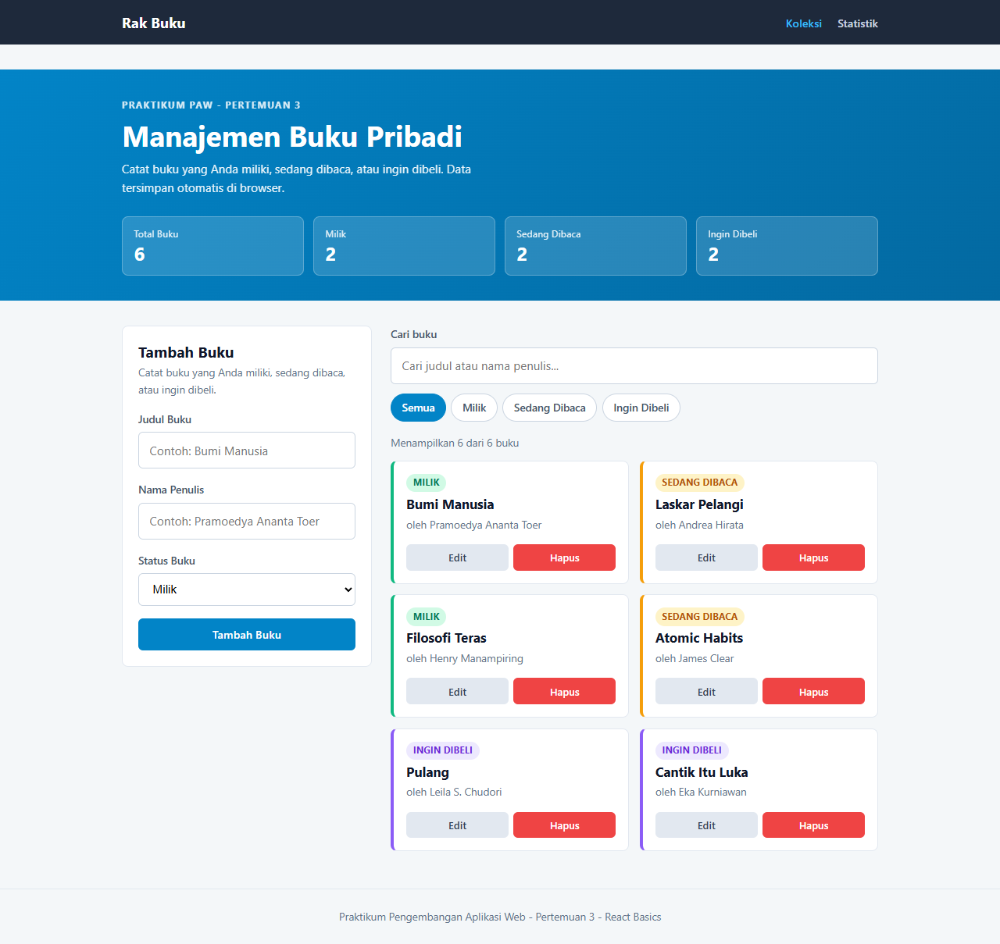
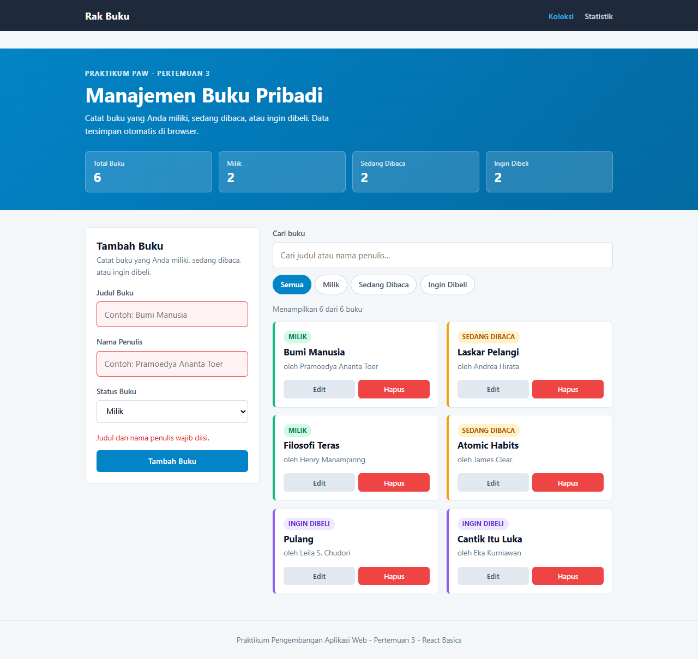
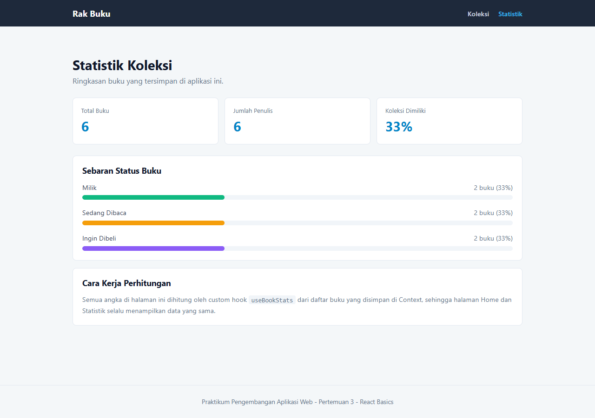
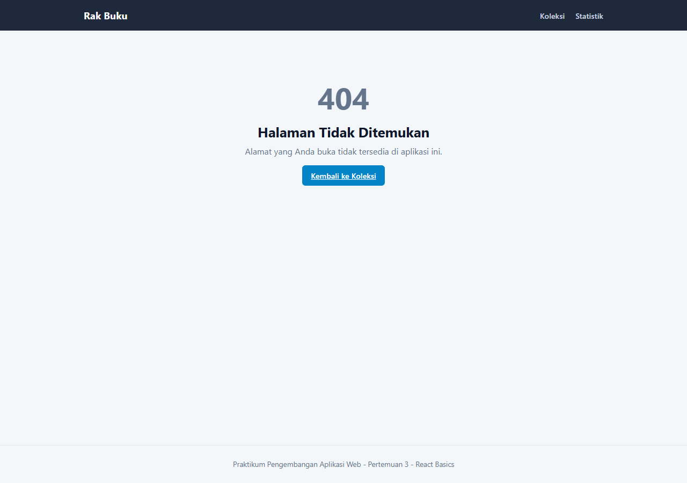
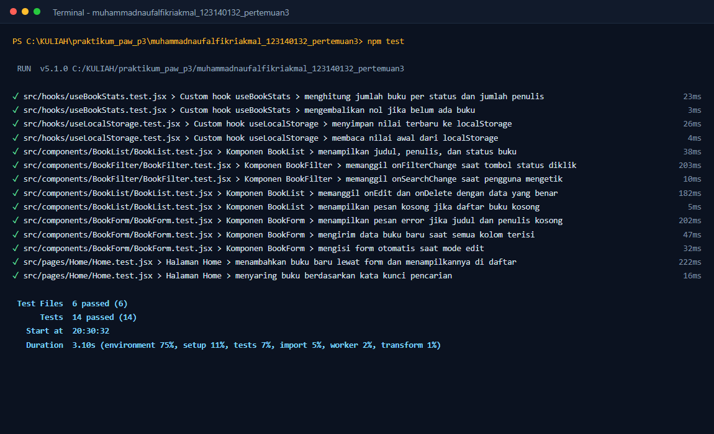

# Rak Buku - Manajemen Buku Pribadi

Praktikum Pengembangan Aplikasi Web - Pertemuan 3: React Basics

Nama: Muhammad Naufal Fikri Akmal
NIM: 123140132
Program Studi: Teknik Informatika - ITERA

---

## 1. Deskripsi Aplikasi

**Rak Buku** adalah aplikasi manajemen buku pribadi yang dibuat dengan React.
Pengguna dapat mencatat buku yang sudah dimiliki, buku yang sedang dibaca, dan
buku yang ingin dibeli. Semua data tersimpan otomatis di `localStorage` browser,
jadi daftar buku tidak hilang ketika halaman di-refresh.

Aplikasi memiliki dua halaman utama:

- **Koleksi** (`/`) - form tambah/edit buku, filter status, pencarian, dan daftar buku.
- **Statistik** (`/stats`) - ringkasan jumlah buku, jumlah penulis, dan sebaran status.

Selain itu ada halaman **404** untuk URL yang tidak dikenal.

## 2. Fitur Aplikasi

- Tambah buku baru (judul, penulis, status: milik / baca / beli).
- Edit buku: tombol **Edit** mengisi form dengan data buku yang dipilih.
- Hapus buku dengan dialog konfirmasi.
- Filter buku berdasarkan status (Semua / Milik / Sedang Dibaca / Ingin Dibeli).
- Pencarian buku berdasarkan judul **atau** nama penulis.
- Validasi form: judul dan penulis wajib diisi, input yang kosong diberi border merah
  dan pesan error.
- Data tersimpan otomatis di `localStorage` (key: `buku_data`).
- Ringkasan statistik di halaman Home dan halaman Statistik.

## 3. Teknologi

- React 19 (functional components + hooks)
- Vite 8 (build tool dan dev server)
- React Router 7 (`BrowserRouter`, `Routes`, `Route`, `NavLink`)
- PropTypes (type checking props)
- Vitest + React Testing Library + jest-dom (unit test)
- CSS biasa (tanpa framework tambahan)

## 4. Cara Menjalankan

Prasyarat: Node.js versi 18 ke atas dan npm.

```bash
# 1. masuk ke folder project
cd muhammadnaufalfikriakmal_123140132_pertemuan3

# 2. install semua dependency
npm install

# 3. jalankan development server
npm run dev
```

Buka alamat yang muncul di terminal, biasanya `http://localhost:5173`.

Perintah lain:

```bash
npm test        # menjalankan semua unit test sekali (vitest run)
npm run test:watch  # mode watch
npm run build   # build production ke folder dist
npm run preview # melihat hasil build
```

## 5. Struktur Folder

```text
muhammadnaufalfikriakmal_123140132_pertemuan3/
├── docs/
│   ├── screenshot-home.png
│   ├── screenshot-validasi.png
│   ├── screenshot-stats.png
│   ├── screenshot-404.png
│   ├── screenshot-test.png
│   └── test-output.txt
├── public/
│   └── favicon.svg
├── src/
│   ├── components/
│   │   ├── BookForm/      BookForm.jsx, BookForm.css, BookForm.test.jsx
│   │   ├── BookFilter/    BookFilter.jsx, BookFilter.css, BookFilter.test.jsx
│   │   ├── BookList/      BookList.jsx, BookList.css, BookList.test.jsx
│   │   └── Navbar/        Navbar.jsx, Navbar.css
│   ├── context/
│   │   └── BookContext.jsx
│   ├── hooks/
│   │   ├── useLocalStorage.js
│   │   ├── useLocalStorage.test.jsx
│   │   ├── useBookStats.js
│   │   └── useBookStats.test.jsx
│   ├── pages/
│   │   ├── Home/          Home.jsx, Home.css, Home.test.jsx
│   │   ├── Stats/         Stats.jsx, Stats.css
│   │   └── NotFound/      NotFound.jsx, NotFound.css
│   ├── utils/
│   │   └── status.js      daftar status buku (milik / baca / beli)
│   ├── App.jsx
│   ├── App.css
│   ├── index.css
│   ├── main.jsx
│   └── setupTests.js
├── index.html
├── package.json
└── vite.config.js
```

## 6. Screenshot Antarmuka

### Halaman Koleksi



### Validasi Form (input kosong)



### Halaman Statistik



### Halaman 404



## 7. Fitur React yang Digunakan

| Fitur React | Penjelasan | Lokasi Kode |
|---|---|---|
| Functional component | Semua tampilan dibuat sebagai function component | `src/components/*`, `src/pages/*` |
| JSX | Markup UI ditulis di dalam JavaScript | semua file `.jsx` |
| Props | Data dikirim dari parent ke child | `BookForm`, `BookFilter`, `BookList` |
| PropTypes | Validasi tipe props setiap komponen | bagian bawah setiap file komponen |
| `useState` | Menyimpan isi form, filter, kata kunci, buku yang diedit | `BookForm.jsx`, `Home.jsx`, `useLocalStorage.js` |
| `useEffect` | Menyimpan ke localStorage, mengisi form saat mode edit | `useLocalStorage.js:18`, `BookForm.jsx:20` |
| `useContext` + Context API | Data buku dipakai bersama tanpa prop drilling | `BookContext.jsx`, `Home.jsx`, `Stats.jsx` |
| Custom hook | Logika stateful dipisah dari komponen | `useLocalStorage.js`, `useBookStats.js` |
| React Router | Navigasi multi-halaman tanpa reload | `App.jsx:18-22`, `Navbar.jsx:9-20` |
| Conditional rendering | Empty state, mode tambah/edit, statistik kosong | `BookList.jsx:11`, `BookForm.jsx:52-56`, `Stats.jsx:36` |
| Rendering list + key | Daftar buku dirender dengan `map()` dan `key={book.id}` | `BookList.jsx:21-34` |
| Controlled component | Nilai input dikendalikan state React | `BookForm.jsx:60-97`, `BookFilter.jsx:8-19` |
| Event handling | `onSubmit`, `onChange`, `onClick` | `BookForm.jsx:33`, `BookFilter.jsx:26`, `BookList.jsx:28` |

### Komponen Reusable

1. **BookForm** - dipakai untuk mode tambah dan mode edit buku.
2. **BookFilter** - dipakai untuk pencarian dan filter status.
3. **BookList** - dipakai untuk menampilkan daftar buku (termasuk empty state).
4. **Navbar** - navigasi yang dipakai di semua halaman.

### Custom Hook

- **`useLocalStorage(key, initialValue)`** - menyimpan state ke localStorage dan
  membacanya kembali saat aplikasi dibuka. Dipakai di `BookContext`.
- **`useBookStats(books)`** - menghitung `total`, `milik`, `baca`, `beli`,
  `penulis`, dan `persenMilik`. Dipakai di `Home` dan `Stats`.

### Context API

`BookProvider` di `src/context/BookContext.jsx` menyimpan state buku beserta fungsi
`addBook`, `updateBook`, dan `deleteBook`. Semua halaman yang dibungkus provider
dapat memanggil `useBooks()` tanpa perlu menerima props dari `App`.

## 8. Validasi dan Error Handling

- Judul dan penulis wajib diisi. Jika kosong, form menampilkan pesan
  "Judul dan nama penulis wajib diisi." dengan `role="alert"` dan input diberi
  border merah (class `input-error`).
- Penghapusan buku memakai `window.confirm` agar tidak terhapus karena salah klik.
- `useLocalStorage` memakai `try/catch` supaya aplikasi tetap berjalan ketika
  localStorage tidak dapat diakses (misalnya mode privat) atau data JSON rusak.

## 9. Testing

Test dijalankan dengan Vitest dan React Testing Library:

```bash
npm test
```

Hasil eksekusi: **14 test pada 6 file test, semuanya lulus**.



Output lengkap juga tersimpan di `docs/test-output.txt`.

| File test | Jumlah | Yang diuji |
|---|---|---|
| `BookForm.test.jsx` | 3 | validasi input kosong, pengiriman data buku baru, form otomatis terisi saat edit |
| `BookFilter.test.jsx` | 2 | perubahan filter status, perubahan kata kunci pencarian |
| `BookList.test.jsx` | 3 | tampilan judul/penulis/status, callback edit & hapus, tampilan daftar kosong |
| `useBookStats.test.jsx` | 2 | perhitungan statistik, kondisi belum ada buku |
| `useLocalStorage.test.jsx` | 2 | menyimpan ke localStorage, membaca nilai awal |
| `Home.test.jsx` | 2 | tambah buku lewat form, pencarian buku |

Konfigurasi testing ada di `vite.config.js` (environment `jsdom` dan file
`src/setupTests.js`).

## 10. Penyimpanan Data

Data buku disimpan sebagai JSON di `localStorage` dengan key `buku_data`, contoh isinya:

```json
[
  {
    "id": 1717400000001,
    "title": "Bumi Manusia",
    "author": "Pramoedya Ananta Toer",
    "status": "milik"
  }
]
```

Nilai `status` yang dipakai: `milik`, `baca`, dan `beli`
(didefinisikan di `src/utils/status.js`).

## 11. Pemenuhan Kriteria Penilaian

| Aspek | Bobot | Keterangan |
|---|---|---|
| Fungsi dasar aplikasi | 30% | Tambah, edit, hapus, filter status, pencarian judul/penulis, data persisten |
| Penerapan konsep React | 25% | Functional components, hooks, props, Context API, Router, custom hooks, PropTypes |
| Struktur kode dan organisasi | 20% | Folder `components`, `pages`, `hooks`, `context`, `utils`; CSS dipisah per komponen |
| Testing dan error handling | 15% | 14 unit test RTL/Vitest, validasi form, konfirmasi hapus, try/catch localStorage |
| Dokumentasi | 10% | README ini, screenshot, komentar pada bagian penting kode |
