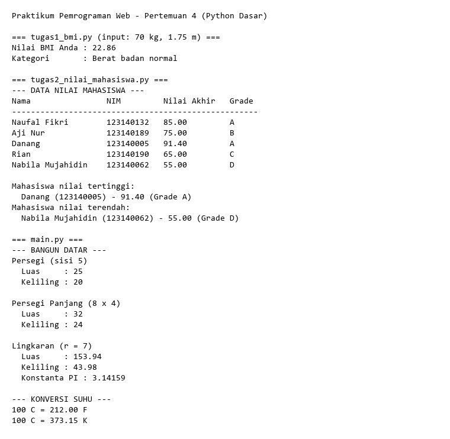

# Praktikum Pemrograman Web - Pertemuan 4 (Python Dasar)

**Nama:** Muhammad Naufal Fikri Akmal  
**NIM:** 123140132  
**Kelas:** RA

---

## 1. Deskripsi Program

### tugas1_bmi.py
Program penghitung BMI (Body Mass Index). Menerima input berat (kg) dan tinggi (m),
menghitung BMI, lalu menampilkan kategori: berat kurang, normal, berlebih, atau obesitas.

### tugas2_nilai_mahasiswa.py
Pengelolaan data nilai 5 mahasiswa. Menghitung nilai akhir dengan bobot
30% UTS + 40% UAS + 30% Tugas, menentukan grade A-E, menampilkan tabel rapi,
serta mencari nilai tertinggi dan terendah.

### math_operations.py
Modul matematika berisi fungsi luas dan keliling untuk persegi, persegi panjang,
dan lingkaran, serta konversi suhu Celsius ke Fahrenheit dan Kelvin. Memiliki
konstanta PI.

### main.py
Program utama yang mengimpor modul math_operations dengan dua cara berbeda
(`import ... as` dan `from ... import ...`) dan menampilkan hasil kalkulasi.

---

## 2. Cara Menjalankan

Buka folder ini di terminal/VS Code, lalu jalankan:

```bash
python tugas1_bmi.py
python tugas2_nilai_mahasiswa.py
python main.py
```

Untuk tugas1, masukkan berat (kg) dan tinggi (m) saat diminta.

---

## 3. Struktur Folder

```text
muhammadnaufalfikriakmal_123140132_pertemuan4/
├── .gitignore
├── README.md
├── tugas1_bmi.py
├── tugas2_nilai_mahasiswa.py
├── math_operations.py
├── main.py
└── docs/
    └── screenshot.png
```

---

## 4. Screenshot Hasil Eksekusi

