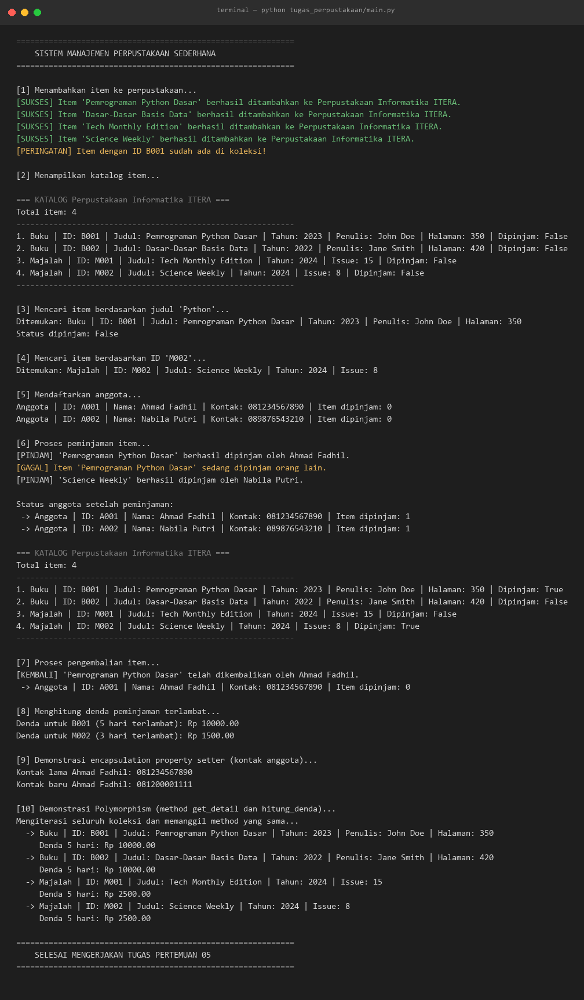

# Praktikum Pemrograman Web — Pertemuan 5 (Python OOP)

**Nama:** Muhammad Naufal Fikri Akmal  
**NIM:** 123140132  
**Kelas:** RA  
**Mata Kuliah:** Pemrograman Web (Praktikum)

---

## 1. Deskripsi Program

### Sistem Manajemen Perpustakaan Sederhana

Program ini merupakan implementasi sistem manajemen perpustakaan sederhana
menggunakan konsep **Object-Oriented Programming (OOP)** pada Python. Sistem
memungkinkan pengelola perpustakaan mengelola koleksi item (buku dan majalah)
serta melayani peminjaman oleh anggota secara terstruktur.

Fitur yang tersedia:

- Menambahkan item (buku / majalah) ke dalam koleksi, lengkap dengan validasi
  duplikasi ID.
- Menampilkan katalog seluruh item beserta status ketersediaannya.
- Mencari item berdasarkan **judul** (pencarian parsial, case-insensitive)
  maupun berdasarkan **ID** (exact match).
- Mendaftarkan **anggota** perpustakaan dan mengelola data kontaknya.
- Memproses **peminjaman** dan **pengembalian** item oleh anggota, termasuk
  mencegah peminjaman ganda pada item yang sama.
- Menghitung denda keterlambatan, dengan tarif berbeda per jenis item.

### Penerapan Empat Pilar OOP

| Pilar | Implementasi pada Program |
|-------|---------------------------|
| **Abstraction** | `LibraryItem(ABC)` mendefinisikan kontrak `get_detail()` dan `hitung_denda()` sebagai `@abstractmethod`. Class ini tidak dapat diinstansiasi langsung. |
| **Inheritance** | `Book` dan `Magazine` mewarisi `LibraryItem` dan memanggil `super().__init__()` untuk inisialisasi atribut dasar. |
| **Encapsulation** | Atribut `_item_id`, `_judul`, `_is_dipinjam` bersifat *protected*; `__koleksi` pada `Library` dan `__kontak` pada `Member` bersifat *private*. Akses data dikontrol via `@property` getter/setter (mis. `is_dipinjam`, `kontak`, `daftar_pinjaman`). |
| **Polymorphism** | `get_detail()` dan `hitung_denda()` di-*override* pada tiap subclass dengan perilaku berbeda. Iterasi koleksi di `main.py` memanggil method yang sama pada objek berbeda tanpa mengetahui tipe spesifiknya. |

### Struktur Berkas Program

| Berkas | Fungsi |
|--------|--------|
| `library_item.py` | Abstract class `LibraryItem` + subclass `Book` & `Magazine` |
| `member.py` | Class `Member` (anggota) dengan *private* `__kontak` & `@property` |
| `library.py` | Class `Library` pengelola koleksi (`__koleksi`) & transaksi peminjaman |
| `main.py` | Skrip eksekusi & demonstrasi seluruh fitur |

---

## 2. Cara Menjalankan Program

Buka terminal pada folder `tugas_perpustakaan/`, lalu jalankan:

```bash
python main.py
```

Atau dari root folder pertemuan:

```bash
cd tugas_perpustakaan
python main.py
```

> **Prasyarat:** Python 3.10 atau lebih baru. Program utama
> (`library_item.py`, `member.py`, `library.py`, `main.py`) tidak memerlukan
> dependensi eksternal — seluruhnya memakai standard library Python.

> **Catatan:** Berkas `generate_screenshot.py` membutuhkan **Pillow** dan hanya
> dipakai untuk membuat gambar screenshot dokumentasi, bukan bagian dari
> program utama. Screenshot yang ada di `screenshot/output.png` sudah dibuat
> dengan skrip ini.

---

## 3. Struktur Folder

```text
muhammadnaufalfikriakmal_123140132_pertemuan5/
├── .gitignore
├── README.md
├── generate_screenshot.py        # helper render screenshot (opsional)
├── screenshot/
│   └── output.png                # screenshot hasil eksekusi
├── latihan/
│   ├── 01_everything_is_object.py
│   ├── 01_procedural_vs_oop.py
│   ├── 02_class_object.py
│   ├── 03_inheritance.py
│   ├── 04_encapsulation.py
│   ├── 05_polymorphism.py
│   └── 06_abstract_class.py
└── tugas_perpustakaan/
    ├── library_item.py
    ├── member.py
    ├── library.py
    └── main.py
```

---

## 4. Screenshot Hasil Eksekusi

Berikut tangkapan layar terminal saat program `main.py` dijalankan. Screenshot
mendemonstrasikan seluruh fitur: penambahan item, penampilan katalog, pencarian
berdasarkan judul & ID, pendaftaran anggota, peminjaman & pengembalian item,
perubahan kontak anggota via property, perhitungan denda, serta demonstrasi
polymorphism.



---

## 5. Ringkasan Hasil Eksekusi

1. **Penambahan item** — 4 item berhasil ditambahkan (2 buku, 2 majalah);
   item dengan ID duplikat (`B001`) ditolak dengan peringatan.
2. **Katalog** — menampilkan seluruh item lengkap dengan detail dan status
   `Dipinjam: False`.
3. **Pencarian judul** — kata kunci `"Python"` menemukan
   *Pemrograman Python Dasar*.
4. **Pencarian ID** — ID `M002` menemukan *Science Weekly*.
5. **Pendaftaran anggota** — dua anggota (`A001`, `A002`) berhasil terdaftar
   dengan data kontak terenkapsulasi.
6. **Peminjaman** — `B001` dipinjam Ahmad dan `M002` dipinjam Nabila; percobaan
   meminjam item yang sama dua kali ditolak.
7. **Pengembalian** — `B001` dikembalikan Ahmad, status pinjamannya kembali 0.
8. **Perhitungan denda** — buku (Rp 2.000/hari) dan majalah (Rp 500/hari)
   menghasilkan nominal berbeda sesuai tarifnya.
9. **Property setter** — kontak Ahmad berhasil diubah melalui setter
   terenkapsulasi.
10. **Polymorphism** — iterasi koleksi memanggil `get_detail()` dan
    `hitung_denda()` seragam pada objek bertipe berbeda.

---

## 6. Latihan Mandiri

Folder `latihan/` berisi tujuh berkas latihan sesuai modul praktikum:

1. `01_everything_is_object.py` — membuktikan semua tipe data Python adalah objek.
2. `01_procedural_vs_oop.py` — perbandingan pendekatan prosedural vs OOP.
3. `02_class_object.py` — class `Mahasiswa` dengan atribut class/instance & dunder method.
4. `03_inheritance.py` — hirarki `Kendaraan` → `Mobil` / `Motor` / `MobilListrik`.
5. `04_encapsulation.py` — sistem rekening bank dengan name mangling & `@property`.
6. `05_polymorphism.py` — gateway pembayaran multi-metode & operator overloading.
7. `06_abstract_class.py` — abstract class `Shape` dan interface `DatabaseConnector`.